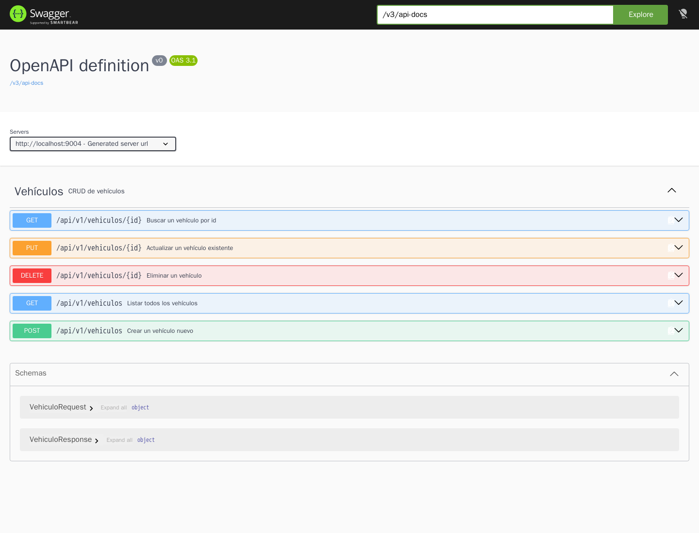
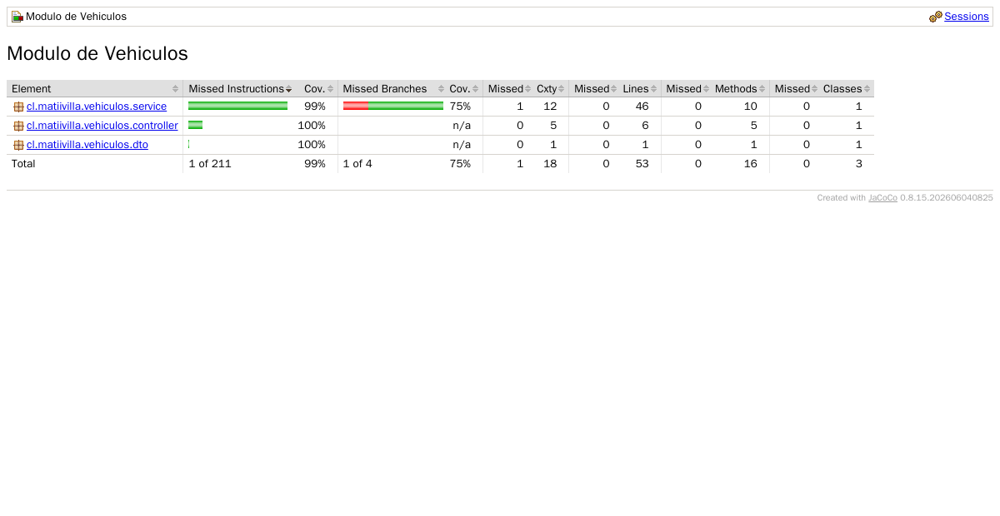

# ms-vehiculos

Microservicio de vehículos con su pipeline de CI/CD en GitHub Actions.

Evaluación Parcial 2 — DOY0101 Ingeniería DevOps, Duoc UC.
Integrantes: Lino Requena y Arion Ruiz-Tagle.

El servicio viene del microservicio que hicimos en la evaluación anterior. Para esta entrega lo
sacamos del monorepo y lo dejamos autocontenido (cuelga directo del parent de Spring Boot en lugar
del POM agregador "biblioteca"), porque el pipeline tiene que poder construir el módulo solo.

Stack: Java 21, Spring Boot 4.1.2, Spring Data JPA, MySQL 8.4, Swagger/OpenAPI, Maven.

## Qué expone

Corre en el puerto **9004**.

| Método | Ruta | Qué hace |
|---|---|---|
| GET | `/api/v1/vehiculos` | Lista todos |
| GET | `/api/v1/vehiculos/{id}` | Busca uno (404 si no está) |
| POST | `/api/v1/vehiculos` | Crea (409 si la patente ya existe, 400 si el body no valida) |
| PUT | `/api/v1/vehiculos/{id}` | Actualiza |
| DELETE | `/api/v1/vehiculos/{id}` | Elimina (204) |
| GET | `/actuator/health` | Healthcheck (lo usan Docker y el pipeline) |
| GET | `/actuator/info` | Devuelve el commit que está corriendo |
| GET | `/swagger-ui/index.html` | Documentación interactiva |



## Levantarlo en local

Hay que tener Docker con el plugin de Compose. No se necesita Java ni Maven instalados: todo se
compila dentro de la imagen.

```bash
cp .env.example .env     # y editar las claves
docker compose up -d --wait
```

El `--wait` hace que el comando no vuelva hasta que los dos healthchecks estén en verde. Después:

```bash
curl http://localhost:9004/actuator/health
curl http://localhost:9004/api/v1/vehiculos
```

Para bajarlo: `docker compose down` (o `down -v` si además se quiere borrar la base).

El `.env` **no** va al repositorio (está en `.gitignore`). En el servidor lo escribe el pipeline a
partir de los Secrets del repositorio.

## El pipeline

Está en `.github/workflows/ci-cd.yml` y se dispara con push y pull request contra `main`.

```
push / PR a main
      |
      +-- test ............ mvnw verify (JUnit + JaCoCo)      \
      |                                                        > corren en paralelo
      +-- security ........ Snyk SCA + Snyk Code (SAST)       /
                 |
                 v
          build-image ..... build del Dockerfile
                            Trivy sobre la imagen
                            push a GHCR (tag = SHA y latest)
                 |
                 v
            deploy ........ solo en push a main
                            SSH a EC2 + docker compose up
                            smoke test de /health y /info
                 |
                 v
            alert ......... si algo falló, abre un issue
```

En un pull request corren `test`, `security` y `build-image` (sin publicar la imagen), así que si
algo está roto se ve antes de mergear. El `deploy` está condicionado a `github.event_name == 'push'`
y `github.ref == 'refs/heads/main'`.

También hay `concurrency` con `cancel-in-progress`, para que si subimos dos commits seguidos el
primero se cancele y no se pisen dos despliegues.

### La rama main está protegida

El pipeline no sirve de nada si uno puede saltárselo, así que `main` tiene un ruleset que:

- obliga a que todo entre por pull request (no se puede pushear directo),
- exige que pasen tres checks antes de poder mergear: `Pruebas unitarias`,
  `Analisis de seguridad (Snyk)` y `Build y publicacion de imagen`,
- bloquea el force-push y el borrado de la rama.

O sea que ningún commit llega a desplegarse sin haber pasado por los tests, Snyk y Trivy.

### 1. Pruebas unitarias

`./mvnw -B verify` corre los 19 tests y después la verificación de cobertura de JaCoCo.

- `VehiculoServiceTest` (10 tests, Mockito): la lógica de negocio, incluyendo los casos que fallan
  — patente duplicada en el create y en el update, id inexistente en find/update/delete.
- `VehiculoControllerTest` (9 tests, MockMvc): los códigos HTTP de cada endpoint, incluidos 400 por
  patente vacía y por año menor a 1950, 404 y 409.

La puerta de calidad está en el `pom.xml`: la regla `check` de JaCoCo exige **70% de líneas
cubiertas** y el build falla si baja de ahí. Hoy vamos en 53 de 53 líneas (99% de instrucciones).
La clase `BibliotecaVehiculosApplication` está excluida porque es solo el `main`, y el código que
genera Lombok no cuenta gracias a `lombok.addLombokGeneratedAnnotation` en `lombok.config`.

El reporte HTML se sube como artefacto (`reporte-jacoco`) en cada corrida, con `if: always()` para
tenerlo incluso cuando los tests fallan.



### 2. Análisis de seguridad

Dos escaneos de Snyk, los dos con `--severity-threshold=high`, o sea que **cualquier hallazgo alto o
crítico corta el pipeline** y el job queda en rojo:

- `snyk test` — dependencias (SCA).
- `snyk code test` — el código nuestro (SAST).

Las excepciones viven en `.snyk`, versionadas y con fecha de vencimiento. Hoy hay una sola, para
`SNYK-JAVA-ORGGLASSFISHJAXB-20883142`: es una vulnerabilidad de parseo de XML que entra por
Hibernate, no tiene versión parchada todavía y nuestro servicio no recibe XML en ningún endpoint.
La excepción expira el 26-01-2027; cuando venza vuelve a aparecer el hallazgo y hay que revisar si
ya salió el parche.

Aparte, Dependabot (`.github/dependabot.yml`) revisa semanalmente Maven, Docker y las propias
actions, y abre PRs. Como cada PR dispara el pipeline completo, un bump solo se puede mergear si
pasa tests, Snyk y Trivy. Varios commits del historial son exactamente eso.

### 3. Build y publicación de la imagen

El `Dockerfile` es multi-stage:

- **build**: `eclipse-temurin:21-jdk-alpine`. Copia primero `.mvn`, `mvnw` y `pom.xml` y hace
  `dependency:go-offline`, así el `COPY src/` posterior no invalida la capa de dependencias y los
  builds siguientes son mucho más rápidos. Compila con `-DskipTests` porque los tests ya corrieron
  en el job anterior.
- **runtime**: `eclipse-temurin:21-jre-alpine` (sin JDK, imagen más chica). Hace `apk upgrade` para
  tomar parches del sistema, crea el usuario `app` y corre como ese usuario, **no como root**.
  Incluye un `HEALTHCHECK` contra `/actuator/health`.

Después del build, Trivy escanea la imagen con `severity: CRITICAL,HIGH` y `exit-code: 1`, así que
una imagen con vulnerabilidades altas no llega a publicarse. Usamos `ignore-unfixed: true` para no
bloquear por cosas que todavía no tienen parche disponible.

Recién ahí se publica en GHCR con dos tags: el SHA del commit y `latest`.

### 4. Despliegue automático

El job `deploy` entra a una instancia EC2 por SSH:

1. Escribe la llave privada desde `secrets.EC2_SSH_KEY` y agrega el host a `known_hosts` con
   `ssh-keyscan`.
2. Copia el `docker-compose.yml` del repositorio al servidor.
3. Genera el `.env` remoto con los secrets (credenciales de la base, imagen y SHA) y le pone
   permisos `600`.
4. `docker compose pull` + `docker compose up -d --no-build --wait`. El `--no-build` es importante:
   el servidor **no compila nada**, solo baja la imagen que ya pasó por todos los controles.
5. Smoke test (ver más abajo).
6. Si algo falló, imprime los últimos 100 logs de los contenedores.
7. `if: always()` para borrar la llave SSH del runner, pase lo que pase.

Está asociado al environment `staging`, así que los secrets de despliegue no son accesibles desde
los otros jobs.

### 5. Alerta

El job `alert` tiene `if: failure()` y depende de los cuatro anteriores. Si alguno falla en `main`,
abre automáticamente un issue con el SHA corto y el link a la corrida. Es la "alerta si el análisis
de seguridad falla" que pide el encargo, pero lo dejamos para cualquier etapa, no solo seguridad.

## Trazabilidad

La idea es poder mirar el servicio corriendo y saber exactamente de qué commit salió. La cadena:

1. El pipeline pasa `GIT_SHA=${{ github.sha }}` como `build-arg` al Dockerfile.
2. El Dockerfile lo deja en dos lugares: como `LABEL org.opencontainers.image.revision` (metadato de
   la imagen, se lee con `docker inspect`) y como variable de entorno dentro del contenedor.
3. La imagen se publica con ese mismo SHA como tag.
4. El deploy despliega `imagen:SHA`, no `latest`. `latest` existe por comodidad, pero lo que se
   instala es el tag inmutable.
5. `application.yml` expone esa variable en `/actuator/info`.
6. El último paso del deploy hace `curl /actuator/info | grep $GIT_SHA`. **Si lo que está respondiendo
   en el servidor no es el commit que se acaba de construir, el job falla.** No alcanza con que el
   despliegue "no tire error": tiene que contestar el código correcto.

Así se ve en el contenedor levantado en local sobre el commit `59895fc`:

```
$ curl -s http://localhost:9004/actuator/info
{"git-sha":"59895fc52704d22e5c69aae26cb63630a1dc7eda"}
```

Lo otro que ayuda a la trazabilidad es que todo pasa por PR: Dependabot abre el PR, el pipeline lo
valida, y el merge commit queda en el historial apuntando a la corrida que lo aprobó.

## Escalabilidad y seguridad del despliegue

Lo que ajustamos en `docker-compose.yml`:

- **Límites de recursos** por servicio: 1 CPU y 512M de memoria para la app y para MySQL.
- **JVM acotada a mano** (`-Xmx256m -Xss512k -XX:MaxMetaspaceSize=128m -XX:+UseSerialGC`) para que
  la app quepa junto a la base en la instancia. El Dockerfile trae `MaxRAMPercentage=75` con
  `UseContainerSupport` como valor por defecto cuando no se pasa nada.
- **MySQL ajustado** para instancia chica: `performance-schema=OFF`, buffer pool de 128M,
  50 conexiones máximo y binlog desactivado.
- **Orden de arranque real**: la app tiene `depends_on` con `condition: service_healthy`, no solo
  `depends_on` a secas. No intenta conectarse a una base que todavía está inicializando.
- **Healthchecks en los dos servicios** y `restart: unless-stopped`, así Docker reinicia solo si un
  contenedor se cae.
- **Red interna**: MySQL no publica puertos al host, solo la app expone el 9004.

Y del lado del pipeline:

- `permissions: contents: read` a nivel de workflow, y los permisos extra (`packages: write`,
  `issues: write`) se dan solo en el job que los necesita.
- Ninguna credencial está en el repositorio. `application.yml` no tiene valores por defecto para
  usuario y clave, así que si faltan las variables la app ni siquiera arranca.
- El `.dockerignore` deja fuera `.env`, `.git` y `.github` para que no terminen dentro de la imagen.

## Evidencia de que corre

Salida real del servicio levantado con `docker compose up -d --wait`:

```
$ docker compose ps
NAME           IMAGE                SERVICE   STATUS
ms-vehiculos   ms-vehiculos:local   app       Up (healthy)   0.0.0.0:9004->9004/tcp
vehiculos-db   mysql:8.4            db        Up (healthy)   3306/tcp

$ curl -s http://localhost:9004/actuator/health
{"groups":["liveness","readiness"],"status":"UP"}

$ curl -s -X POST http://localhost:9004/api/v1/vehiculos -H 'Content-Type: application/json' \
    -d '{"patente":"KWYZ11","marca":"Toyota","modelo":"Yaris","anio":2020,"color":"Rojo","tipo":"Sedan","disponible":true}'
{"id":1,"patente":"KWYZ11","marca":"Toyota","modelo":"Yaris","anio":2020,"color":"Rojo","tipo":"Sedan","disponible":true}

# la misma patente de nuevo -> 409
# patente vacía y año 1900 -> 400
# id 99 -> 404
```

Y los tests:

```
$ ./mvnw -B verify
[INFO] Tests run: 19, Failures: 0, Errors: 0, Skipped: 0
[INFO] --- jacoco:0.8.15:check (check) @ cl-matiivilla-vehiculos ---
[INFO] BUILD SUCCESS
```

## Problemas que tuvimos

Los dejamos anotados porque fueron la mitad del trabajo:

- **`mvnw` sin permiso de ejecución.** El archivo estaba versionado sin el bit `+x`, así que el
  build de la imagen moría con "permission denied". Hubo que versionar el bit de ejecución, y además
  el Dockerfile hace `chmod +x mvnw` por si acaso.
- **La instancia se quedaba sin memoria.** MySQL con la configuración por defecto más la JVM sin
  límite no cabían juntos y el contenedor de la app se moría apenas arrancaba. De ahí salieron los
  `deploy.resources.limits`, el `JAVA_OPTS` acotado y el ajuste del buffer pool de MySQL.
- **Un hallazgo crítico de Snyk sin parche.** `jaxb-core`, que entra por Hibernate. Primero fijamos
  a mano las versiones de Jackson que sí tenían arreglo, y para el que no existía versión parchada
  dejamos la excepción documentada en `.snyk` con fecha de expiración, en vez de bajar el umbral de
  severidad y dejar pasar todo.
- **`trivy-action` con el tag mal.** La versión que teníamos no existía y el job fallaba antes de
  escanear. Quedó fijada en `v0.36.0`.
- **Migración a Spring Boot 4.** Cambian los starters: hay que usar `spring-boot-starter-webmvc` y,
  para los tests de controller, `spring-boot-starter-webmvc-test` con
  `org.springframework.boot.webmvc.test.autoconfigure.WebMvcTest`.
- **La indentación del `environment` en el job de deploy.** Un nivel de más en el YAML y el job
  simplemente no veía los secrets.

## Estructura

```
.github/workflows/ci-cd.yml   el pipeline completo
.github/dependabot.yml        actualizaciones automáticas
Dockerfile                    build multi-stage, runtime sin root
docker-compose.yml            orquestación app + MySQL
.snyk                         excepciones de seguridad con vencimiento
.env.example                  plantilla de variables (el .env real no se sube)
pom.xml                       dependencias y la puerta de cobertura de JaCoCo
src/main/java/...             controller, service, repository, model, dto
src/test/java/...             los 19 tests
```
